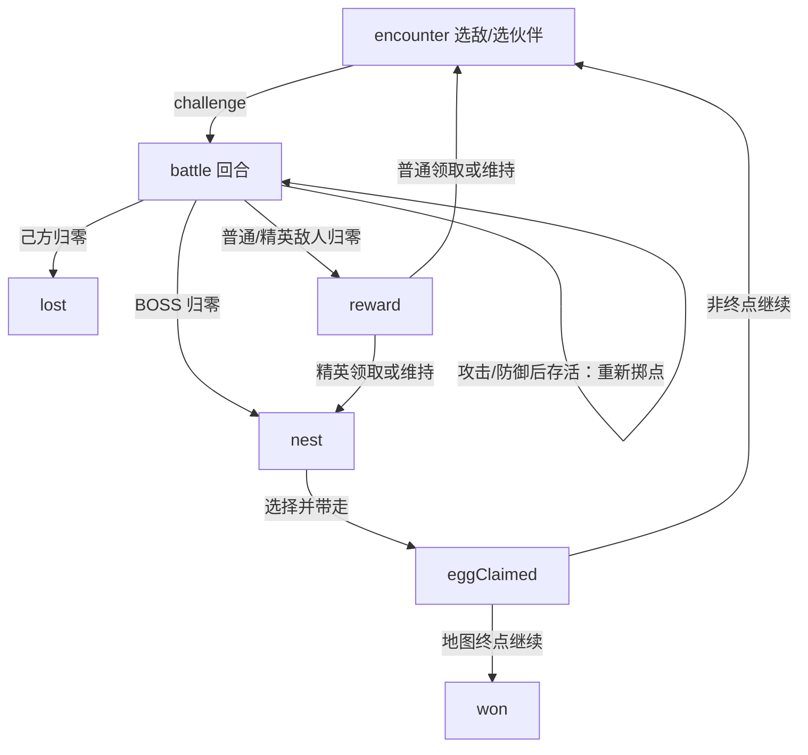

# 游戏设计：当前实现

版本基线：2026-10-19，源码入口 [PMModel.ts](../assets/scripts/PMModel.ts)、[PMGame.ts](../assets/scripts/PMGame.ts)。数值见 [BALANCE](BALANCE.md)，明确未实现项见 [STATUS](STATUS.md)。

## 产品与核心循环

面向手机休闲玩家的竖屏宠物收集与随机点数战斗。主要选择是：面对哪只敌人、带哪只伙伴、何时使用药水或防御、是否替换本局点数组、带走哪枚蛋、怎样孵化与遗传。角色为原创宠物，视觉采用明亮动漫轮廓、赛璐璐色块和经典收集冒险的亲切感。

营地 → 选择地图 / 续玩 → 选择敌人与出战伙伴 → 回合战斗 → 战利品 / 巢穴 → 下一关 → 通关解锁地图。蛋带回孵化屋产生独立个体；伙伴编队、交配和好友结缘构成长期收集循环。

**短期进度**是当前地图的一次探险：生命比例、HP 上限加成、攻击与治疗点数、药水库存、关卡和敌人。**长期进度**是宠物个体、蛋、孵化、交配、能量、通关记录及结缘系列。重开探险保留长期进度，重置短期进度。地图不是可自由行走的开放场景。

## 页面与操作

| 页面 | 内容与主操作 | 返回与数据约束 |
|---|---|---|
| 营地 | 当前伙伴、探险、伙伴、孵化屋、交配屋、来信、一个待开放入口 | 启动进入营地；返回不重开探险 |
| 探险地图 | 三张地图、系列预览、关数、解锁与蛋信息；继续 / 出发 | 未通关上一图不能开始下一图；中途换地图提示丢弃本局进度 |
| 选择敌人 | 敌方头像、名称、全部攻击点数、HP、单项奖励；我方同构数据、药水、3 个队伍槽 | 切伙伴只刷新我方区，敌人、奖励及挑战按钮保持；非 BOSS 可刷新两次 |
| 战斗 | 敌人本回合攻击、我方生命与技能状态；治疗、力量、防御、攻击四按钮 | 不允许战斗中改队；药水是本回合辅助行动，攻击 / 防御结束行动 |
| 普通 / 精英胜利 | 当前单项奖励；攻击或治疗点数组显示新 / 原二选一 | 领取或维持后恢复生命；精英接寻蛋，普通进入下一关 |
| 巢穴 | 精英 2 次 / BOSS 3 次翻找，候选蛋可回选，只带一枚 | 次数用完默认最高品质，同品质取最早；提前带走允许；确认后单独继续 |
| 通关 / 失败 | 伙伴、记录、继续下一地图 / 重开、查看伙伴 | 收藏不丢；失败没有当前敌人胜利奖励 |
| 伙伴 | 已拥有个体 / 54 形态图鉴，6 张卡一页；上方出战＋候补 1＋候补 2 | 拖动个体到槽位；已在队中则交换；图鉴未拥有项不可上阵 |
| 孵化屋 / 蛋袋 | 2 槽、倒计时、能量加速、领取、选蛋、可用蛋列表 | 领取揭晓需确认；计时跨页面与退出保留 |
| 交配屋 | 一雌一雄选择、结果规则、30 分钟、领取蛋 | 领取时永久消耗父母，重要后果在确认中保留 |
| 来信 | 来访码导入、分享自己的伙伴、结缘系列及用蛋选择 | 访客是快照，不能编队或当作交配父母 |
| 设置 / 帮助 | 返回营地、重开确认、必要规则 | 复用短弹层；日常功能使用全屏页 |

图标承担重复语义，保留名字、关键数字、重要消耗和简短行动文案。各页面精确布局入口见 [美术与界面](ART-UI.md)。

## 战斗状态机

`screen` 是界面路由，`phase` 是探险状态，两者不可混用。查看营地、孵化或伙伴不会把 `battle` 改成 `encounter`。旧 `recruit/team` 状态仅为存档兼容存在，不再发放伙伴。

## 战斗设计约束

- 每回合先确定我方攻击、治疗点数、敌方攻击以及两种药水倍率；所有按钮使用同一组已掷值，点击或刷新不重新随机。
- 治疗、力量每回合各最多一次。已使用或库存为零变灰；已使用带勾；满血时治疗禁用。力量用过再选防御有确认，药水不会返还。
- 生命按队伍共享的比例保存。换成不同 HP 上限宠物会换算显示值，不是每个候补各存一条可轮换补血的血槽。
- 攻击升级只替换当前出战个体本局的点数组；队伍来回换应保留其本局升级。治疗点数组与 HP 加成为本局共享。
- 技能自动触发，无额外按钮；敌人目前没有同套被动技能执行逻辑。
- 攻击随机数组不是六面点数限制；可以显示 9、18 等数字。图标表示“随机攻击”，具体点数单独显示。

## 收集、繁殖与社交

初始赠送 **闪尾狐 R、岩背龟 R** 两个个体，第三槽空；芽芽龙素材存在，但不等于新存档拥有它。之后只能孵出新宠物。R / SR / SSR 是独立形态，当前没有消耗材料把既有个体直接进化的按钮。

自然孵化每只一个品质对应技能；重复形态也保留为新 UID，随机性别各 50%，不转换能量。交配让不同形态、生命、攻击和技能重新组合，最多六个不同技能；遗传不继承探险临时升级。

交配当前仅一项并行任务，父母直到领取蛋才消失。若没有可出战个体，探险禁用，孵化仍可进行，孵出后恢复可用队伍。好友来访不直接赠送宠物或蛋：互动解锁系列，用自己的蛋定向孵化，保留原蛋品质，防止从好友 SSR 外观直接复制 SSR。

## 迭代时需要保持的体验

先交付可测试版本，再由用户判断下一轮。新增内容应尽量扩展现有数据、卡片和状态，不引入重复的养成页面。所有不可逆消耗、已选随机结果、奖励领取要先保存；动画负责表现，不能决定随机结果或是否发奖。
